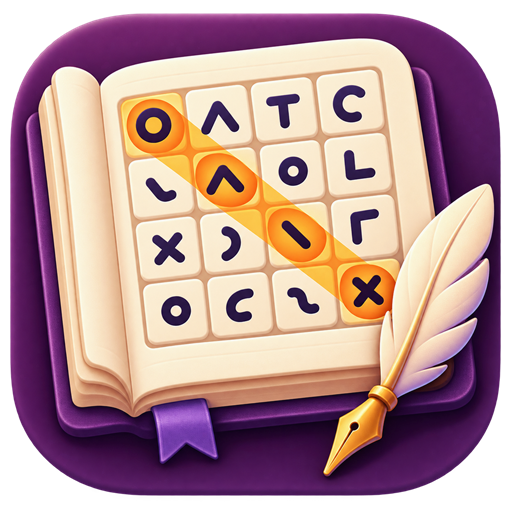
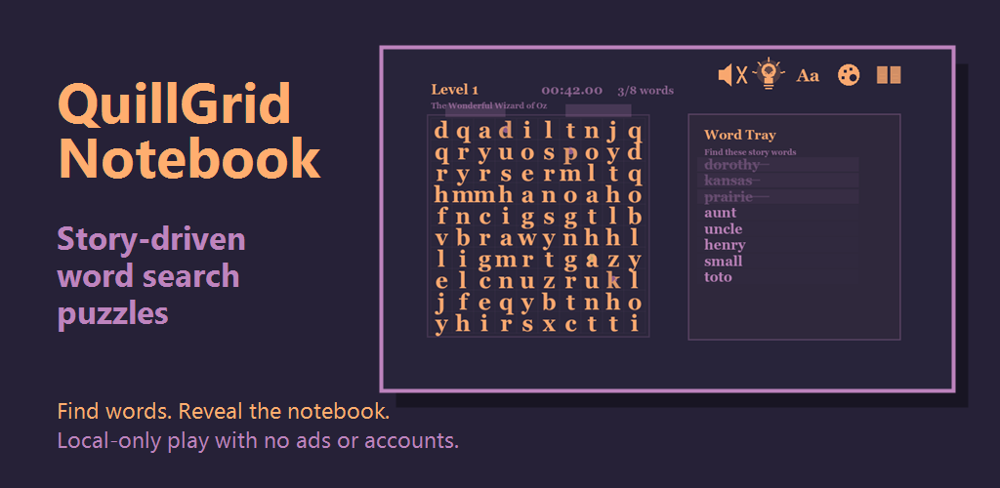
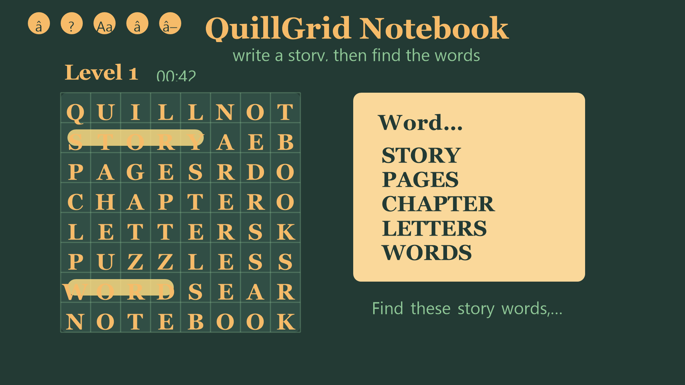
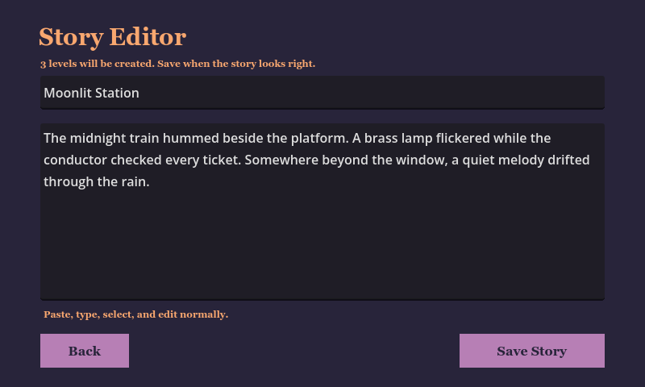
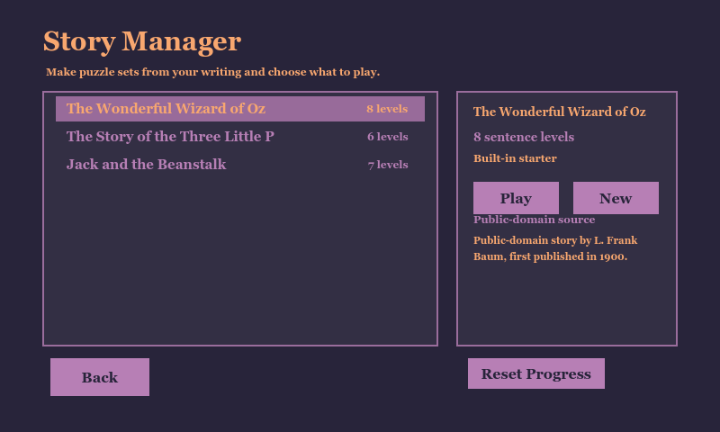
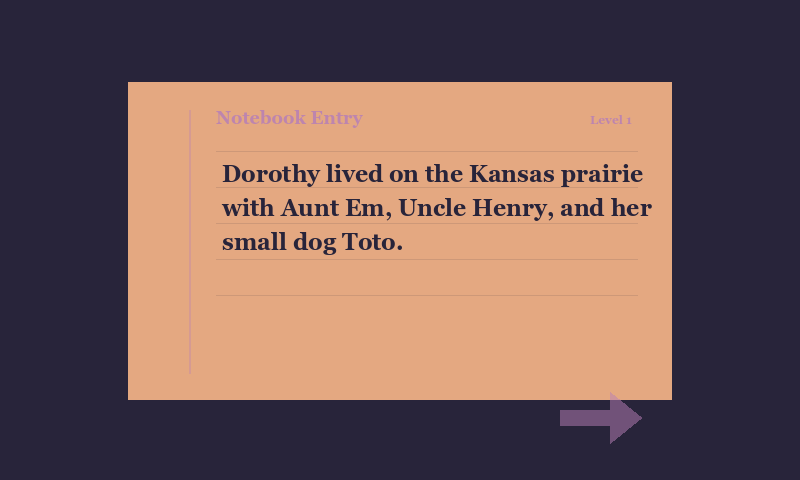

# QuillGrid Notebook

**Status: Finished and publicly released on Google Play.**

[Install QuillGrid Notebook on Google Play](https://play.google.com/store/apps/details?id=com.carterhowell.quillgridnotebook)

I built QuillGrid Notebook as a small Android word-search game around story-generated letter-grid levels. Players write or paste a story, turn sentences into playable puzzle chapters, and unlock the notebook one completed level at a time.

The project combined game design, Godot UI work, Android export and release engineering, local data handling, store presentation, and production validation into a finished mobile app. The complete game is available to players; this repository is its public project exhibit rather than the active source-code repository.

## What I Built

- I built a Godot 4 Android game with a custom 2D puzzle interface.
- I implemented story-to-level generation for letter-grid gameplay.
- I built, signed, tested, and published the Android App Bundle through Google Play.
- I created store listing copy, screenshots, app icon, feature graphic, and privacy policy.
- I completed Play Console declarations, production rollout, and post-release device testing.

## Gameplay

Players find selected words from each sentence on a letter grid. Solving a level reveals the sentence, gradually building a readable notebook from the player's own writing.

Core features:

- Story editor for pasted or original text.
- Story manager for local story collections.
- Generated puzzle chapters from sentence text.
- Drag-based word selection.
- Completion screen that reveals the solved sentence.
- Local-only progress and settings.
- No account, ads, analytics, cloud sync, or server upload.

## Release Status

- App name: `QuillGrid Notebook`
- Package name: `com.carterhowell.quillgridnotebook`
- Platform: Android
- Engine: Godot 4
- Price: Free
- Current public release: `1.0.10` (version code `11`)
- Google Play status: **published to production**
- Supported Android versions: Android 10 and later
- Distribution: free download from Google Play

Version 1.0.10 completed its production rollout and was verified using the Play-distributed build on Android. The game launches into its complete story editor, puzzle-generation, word-search, progression, and local-save experience.

## Public Pages

- Project page: https://carter-howell.github.io/quillgrid-notebook/
- Google Play: https://play.google.com/store/apps/details?id=com.carterhowell.quillgridnotebook
- Privacy policy: https://carter-howell.github.io/quillgrid-notebook/privacy-policy.html

I keep the privacy policy in `docs/privacy-policy.html` because that URL is used for the Google Play listing.

## Media

I keep store-ready visual assets under `media/`.

### App Icon

### Feature Graphic

### Screenshots

## Build Notes

I built the game in Godot 4 and structured it around a notebook-style progression loop: edit a story, generate playable word-search chapters, solve each grid, and reveal the original sentence after completion. I also kept the app local-first, so stories and progress stay on the device without requiring accounts, ads, analytics, or a backend service.

The release work included Android package configuration, app signing and optimization, store screenshots, icon and feature graphics, Play Console declarations, production rollout, Play-delivery testing, and a privacy-policy page for the listing. The project is complete; future changes are maintenance or optional enhancements rather than unfinished launch work.
